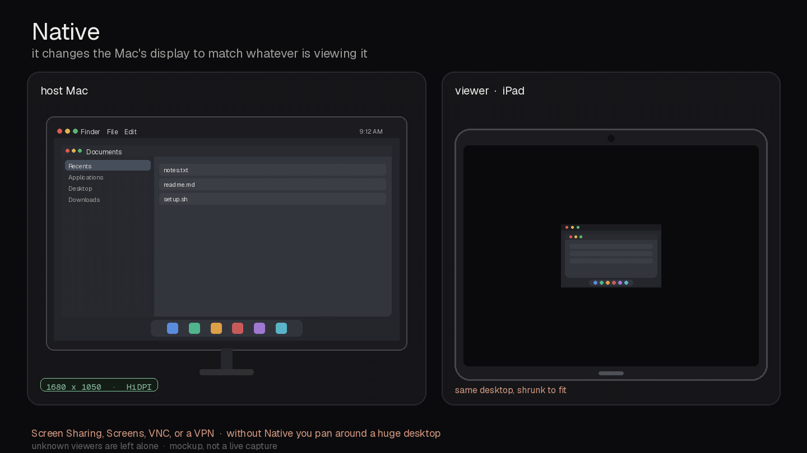
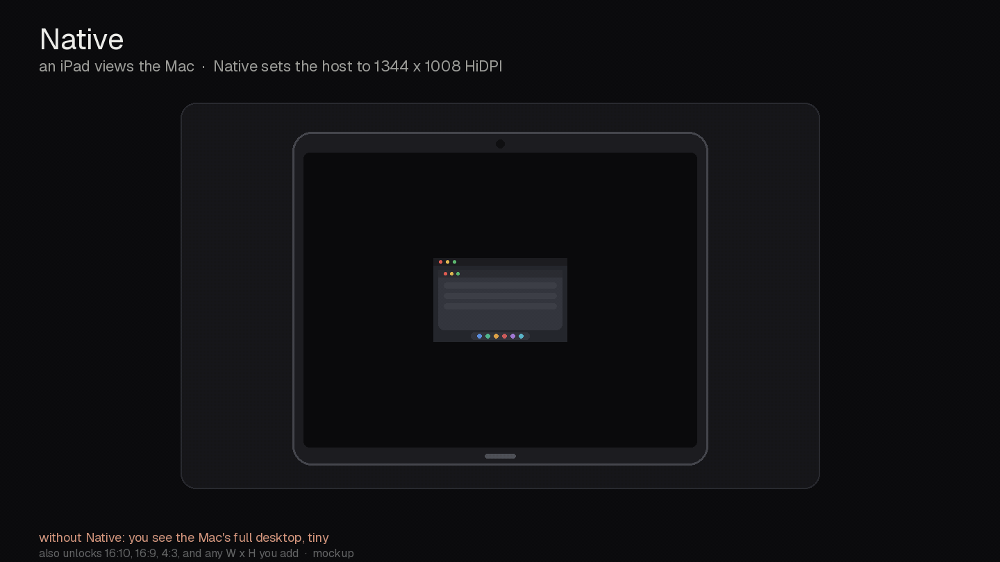
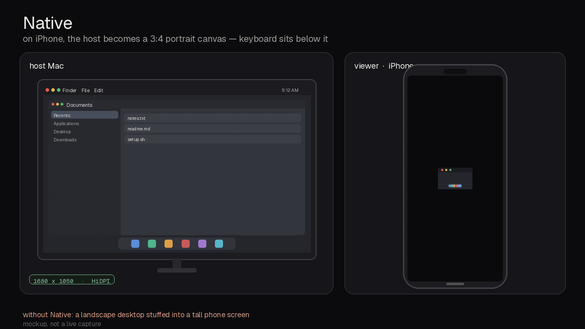

# Native

Native display resizing and desktop reduction for remote devices.

The command is `native`. `nativedisplay` is installed as an alias.

When a tablet, iPhone, or Mac is viewing this Mac, `native` sets the host display to that viewer's logical size. Detection runs on the Mac. The client does not need Native installed or any extra settings. Viewers that connect to the built-in screen sharing ports 5900, 5901, and 3283 are seen. That includes Apple Screen Sharing, Screens, built-in VNC, RealVNC, TightVNC, TigerVNC, and Jump Desktop in VNC mode. A VPN or overlay network is optional and only helps name the device. HiDPI is used when the panel advertises it. The same modes are unlocked on a built-in LCD and on a dummy HDMI panel.

## Demo







Illustrative replay of Native display matching. Tablets stay landscape; iPhone has keyboard room below. See the Native 1.0 behavior notes for fallback matching.

## Install

```sh
git clone https://github.com/hailports/Native.git
cd Native
./install.sh
```

`./install.sh` is the self-guided install. It checks for Python 3, installs with `pipx` when that is present, and otherwise uses `python3 -m pip install --user .` and tells you how to put `native` on PATH (often `~/Library/Python/*/bin` or `~/.local/bin`). It checks for `displayplacer` and, if that is missing, prints `brew install displayplacer`. It does not run setup. The numbered steps it prints continue below.

`displayplacer` applies the mode. Install it with Homebrew. Native does not bundle it.

A Homebrew formula is in `Formula/nativedisplay.rb` (HEAD only, depends on `displayplacer` and `python@3.12`):

```sh
brew install --HEAD --formula ./Formula/native.rb
```

Tailscale is not required. If the `tailscale` command is installed, peer names from `tailscale whois` and `tailscale status` are used. If it is absent, Screen Sharing sockets, reverse DNS, mDNS, and ARP/NDP still name the viewer.

## Setup, once per display

```sh
native setup
```

`native setup` is the self-guided setup on the Mac. It tells you what it is about to do, detects attached displays, backs up any previous override, and writes the scale-resolutions override. That write needs sudo once. `--dry` prints the plan and does not install the file. If `displayplacer` is missing, setup says so and prints `brew install displayplacer`.

The override is installed at:

```
/Library/Displays/Contents/Resources/Overrides/DisplayVendorID-<hex>/DisplayProductID-<hex>
```

Each logical `WxH` is stored as three records: the 1x size (flag 1), the 2x framebuffer (flag 9, tail `0x200000`), and the bare 2x pair. That is what makes macOS treat the size as a native HiDPI mode. Sizes already stored in Apple's shorter 9-byte or 12-byte form are kept when they are not already in the catalog. Other keys in an existing override, including the EDID, are kept.

`setup` does not restart WindowServer. New modes load on the next logout, display unplug/replug, or wake. Do that once on each Mac after setup. Until then, `apply` only selects a mode the panel already advertises.

After `./install.sh`:

1. `native setup`
2. Log out, unplug and replug the display, or wake so the new modes load.
3. `native status` to verify.
4. Optional: `native watch`.

`nativedisplay sentinel` puts the file back if something deletes it. It does not change the live resolution. `nativedisplay add 1210x834` records another client size with the same encoding and merges it on the next setup (or immediately, when a display is detected).

## How a viewer is chosen

`native apply` and `native watch` look for an established Screen Sharing or VNC peer on ports 5900, 5901, and 3283 (`netstat`, then `nettop`, then `lsof`). Any VNC-compatible client on those ports is seen. The client does not need Native installed or extra settings. That is Apple Screen Sharing, Screens, built-in VNC, RealVNC, TightVNC, TigerVNC, and Jump Desktop in VNC mode.

The peer name is resolved in this order:

1. `tailscale whois`, then `tailscale status`, only when the `tailscale` CLI is on the machine. Account fields from whois are not kept.
2. Reverse DNS / the system resolver (mDNS names that the resolver already knows).
3. Hostnames in `arp -a` and `ndp -an`.

Native works with any tablet, not iPad-only. A name with `ipad`, `tablet`, or `tab` is a tablet, including `Galaxy-Tab`, `Pixel-Tablet`, and `SM-X`. Tablets are classified before phones. `iphone`, `ipod`, or the word `phone` is an iPhone, as is `android-phone`. A bare `android`, `pixel`, or `galaxy` is not a family and does not auto-resize. That is safer than rotating a tablet. `macbook`, `imac`, `mac mini`, `mac pro`, `mac studio`, or `mac` is a Mac laptop. `tailscale whois` classifies `iPadOS` as a tablet and `macOS` as a Mac when the hostname did not already match. A bare `iOS` result is not guessed, because it is either an iPhone or an iPad. A bare `android` operating system is not guessed. The hostname still wins: `Galaxy-Tab` with OS `android` is a tablet.

When the Mac can read the tablet's own size (a `WxH` in the hostname, including a 2x framebuffer), Native matches that canvas. Even sizes at or above 2000x1500 are halved before matching. If the size is unknown, the shared 4:3 fallback is 1344x1008, not 1376x1032.

If several viewers match, the iPhone wins, then the tablet, then the Mac.

| Viewer | Mode |
| --- | --- |
| Tablet, size known | Landscape only. A 13-inch iPad Pro that reports 2752x2064 gets 1376x1032. A tablet that reports 2560x1600 gets 1280x800. The match is the nearest same-aspect advertised HiDPI mode. Degree 0. There is no tablet portrait. |
| Tablet, size unknown | Shared 4:3 fallback 1344x1008 HiDPI, unrotated. 1376x1032 is not used as a stand-in. It stays available with `native apply 1376x1032` or `native apply ipad-pro-13`. |
| iPhone | 1024x768 HiDPI, rotated 90, so the focused display is 768x1024, plus the keyboard inset. If that mode is missing, the nearest 4:3 HiDPI mode, such as 800x600, still rotated. Phone rotation and the keyboard inset are phone-only. |
| Mac laptop | 1680x1050 HiDPI. If that mode is missing, the nearest 16:10 HiDPI mode, such as 1440x900. |
| Unnamed public VNC peer | Tablet fallback, 1344x1008 HiDPI, unrotated. This is a Screens Connect-style relay that hides the device name. |
| Unnamed LAN or private peer | Display left unchanged. |
| Bare `android`, `pixel`, or `galaxy` | Display left unchanged. |

An unnamed public address is a globally routed peer. LAN, loopback, link-local, and shared addresses (including typical overlay ranges) are not guessed. If the peer cannot be classified, the display is left as it is.

`nativedisplay local` (and `restore`) pins the desktop and replays the arrangement saved before the first remote change. `nativedisplay auto` follows viewers again. `watch` is a poll (default 2 seconds). It skips a tick when the choice is unchanged, when no viewer is classified, or when the mode list cannot be read.

## Commands

```sh
native setup
native status
native list
native apply                 # current viewer
native apply 1680x1050
native apply --ipad
native apply --iphone
native apply --16x10
native apply --16x9
native add 1210x834
native watch
native local                 # desktop wins
native auto
native sentinel
native reflow --math
native reflow --dry
native reflow --install-agent
```

`--dry` on `setup`, `apply`, `add`, `watch`, and `reflow` prints the action and does not change the display or install the override.

## iPhone keyboard inset

After the desktop is the phone's portrait canvas (1024x768 HiDPI, rotated 90, so the focused display is 768x1024 points), `nativedisplay reflow` keeps windows above the on-screen keyboard.

It runs only when a fresh session file says `mobile_connected=1` and `mobile_profile=iphone`, and the focused display is 768x1024. The measured window bottom is y=761. The keyboard row begins near y=852 (91 points of room). Usable bottom was 963, so the global bottom padding is 202. That padding is global, not per space. The previous global value is saved and put back on the next positively identified non-phone session. Floating windows this tool moved are clamped to y<=761 and restored later. Anyone else is left alone.

Missing, stale (older than 45 seconds), malformed, or future-dated state does nothing. If the window manager that applies the padding is missing, reflow does nothing. `reflow` with no flags is one tick. `--dry` prints the math and does not set padding. `--install-agent` writes a plist and does not load it.

`native list` prints every unlocked logical resolution. The catalog is the usual scaled set across 16:10, 16:9, and 4:3, plus the working canvases 1344x1008 and 1024x768, 1344x840, and other logical sizes including 1376x1032. 1344x1008 is the shared 4:3 tablet fallback when the client size is unknown. 1376x1032 is the 13-inch iPad Pro logical size (framebuffer 2752x2064). It is selected when that client size is known, and `native apply 1376x1032` or `native apply ipad-pro-13` can select it directly. Odd scaled sizes that macOS already builds for one specific LCD stay as they are; this tool adds modes, it does not remove the panel's own list.

If another program is already changing the resolution, do not run `native watch` at the same time. `setup` only writes the override file.

## Tests

```sh
python3 -m pytest
```
